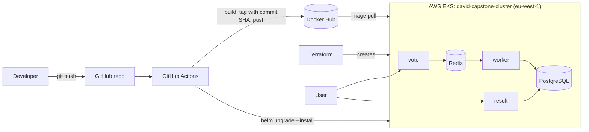

# Capstone 1: Automated EKS Deployment Pipeline (Voting App)

This repository transforms the classic [dockersamples/example-voting-app](https://github.com/dockersamples/example-voting-app) from a local container setup into a fully automated, cloud-native application running on **AWS Elastic Kubernetes Service (EKS)**.

A single commit pushed to the `main` branch triggers an end-to-end pipeline that tests, security-scans, builds, pushes, and deploys the entire application stack. Furthermore, the complete cloud environment can be torn down and rebuilt from infrastructure-as-code in under 10 minutes.

> **Note on Origins:** While the core structural foundation (Terraform scripts, base Helm chart, pipeline skeleton, and worker Dockerfile) originated from an approved community starter template provided for the cohort, all sizing parameters, Kubernetes version choices, Helm templates/values, hardening measures, and pipeline steps have been heavily customized.

---

## Table of Contents

- [System Architecture](#system-architecture)
- [Repository Structure](#repository-structure)
- [Infrastructure Management (Terraform)](#infrastructure-management-terraform)
- [Container Security & Hardening](#container-security--hardening)
- [CI/CD Pipeline (GitHub Actions)](#cicd-pipeline-github-actions)
- [Secrets Management](#secrets-management)
- [Deployment & Verification](#deployment--verification)
- [Resilience & Rollback Testing](#resilience--rollback-testing)
- [Known Limitations & Future Improvements](#known-limitations--future-improvements)

---

## System Architecture



### Data Path Workflow

1. Users submit a choice on the **vote** web interface, which queues the vote inside **Redis**.
2. The background **worker** service consumes the queue item and persists it into **PostgreSQL**.
3. The **result** interface fetches live aggregate counts directly from PostgreSQL.

---

## Repository Structure

| Directory / File | Description |
|---|---|
| `vote/`, `result/`, `worker/` | Source code and customized Dockerfiles for the three application services |
| `terraform/` | Infrastructure-as-code defining the EKS cluster, managed node groups, and IAM boundaries |
| `helm/voting-app/` | Consolidated Helm chart and values configuration managing all five workloads |
| `.github/workflows/deploy.yml` | Automated GitHub Actions CI/CD pipeline definition |
| `docs/screenshots/` | Visual execution records for verification stages |

---

## Infrastructure Management (Terraform)

| Setting | Value |
|---|---|
| **Cloud Region** | `eu-west-1` |
| **Cluster Identifier** | `david-capstone-cluster` (Kubernetes version 1.34) |
| **Compute Resources** | Managed node group of 2 x `t3.large` instances (autoscaling: min 1, max 3) in the default VPC |

**Deviations from defaults:** Upgraded from `t3.small` to support downstream scaling requirements, and targeted Kubernetes 1.34 as older versions (such as 1.30) are deprecated.

### Provisioning & Rebuild Commands

```bash
cd terraform
terraform init
terraform plan -out=tfplan
terraform apply tfplan
aws eks update-kubeconfig --name david-capstone-cluster --region eu-west-1
kubectl get nodes
```

### Disaster Recovery / Rebuild Benchmarks

The environment was successfully torn down and re-provisioned from scratch multiple times.

| Operation | Timing |
|---|---|
| **Tear down** (`terraform destroy`) | Node group (~8m), cluster (~2.5m), total ~10 resources |
| **Re-creation** (`terraform apply`) | Cluster (8m04s), node group (1m44s), **total: 9m57s** |

Post-recreation, pushing to `main` immediately restored application functionality with zero manual intervention aside from configuring pipeline secrets.

---

## Container Security & Hardening

- **Explicit Version Pinning:** Base images reference strict version tags (`python:3.11-slim`, `node:18-slim`, `dotnet/sdk:7.0`, and `dotnet/runtime:7.0`).
- **Non-Root Execution:** All workloads operate under restricted privileges (`vote` and `worker` run as UID `10001`, while `result` executes under the standard `node` user).
- **Build Context Optimization:** Every service directory includes an optimized `.dockerignore` file.
- **Production Build Stages:** The `vote` image uses a multi-stage build, deploying the production-ready `gunicorn` runner stage rather than local development configurations.
- **Unprivileged Port Binding:** To comply with strict non-root constraints on Kubernetes, pods configure the container sysctl parameter `net.ipv4.ip_unprivileged_port_start=0` to bind to restricted ports safely.

---

## CI/CD Pipeline (GitHub Actions)

The workflow defined in `.github/workflows/deploy.yml` executes automatically on every update to `main`:

1. **Smoke Testing:** Initializes the application stack using Docker Compose to verify basic response viability for both frontends (serving as a test suite since none exists upstream).
2. **Vulnerability Assessment:** Executes [Trivy](https://github.com/aquasecurity/trivy) to scan repository files for code vulnerabilities and exposed secrets (`CRITICAL` and `HIGH` severities evaluated in report-only mode).
3. **Container Build & Registry Push:** Concurrently builds images for `vote`, `result`, and `worker`, tagging them with the git commit SHA alongside a `latest` tag on Docker Hub:
   `davidblitx/examplevotingapp_<service>:<commit SHA>`
4. **Automated Kubernetes Deployment:** Authenticates with AWS, targets the EKS cluster, and runs `helm upgrade --install` with `--set global.tag=<commit SHA>` to ensure absolute version parity with the built commit.

**Total pipeline execution time averages approximately 2 minutes 20 seconds.**

---

## Secrets Management

No sensitive credentials exist within version control. Authentication relies entirely on **GitHub Actions Secrets**:

- `DOCKERHUB_USERNAME`
- `DOCKERHUB_TOKEN`
- `AWS_ACCESS_KEY_ID`
- `AWS_SECRET_ACCESS_KEY`

Terraform execution artifacts and local state directories are globally excluded via `.gitignore`.

---

## Deployment & Verification

Once deployed via the automated pipeline, pods can be monitored and accessed via local port-forwarding:

```bash
kubectl get pods
kubectl port-forward svc/vote 8080:5000
kubectl port-forward svc/result 8081:5001
```

- Access the voting portal at <http://localhost:8080>
- Monitor live vote tallies at <http://localhost:8081>

---

## Resilience & Rollback Testing

To test recovery workflows, a deliberately broken deployment was pushed targeting a non-existent container tag:

```bash
helm upgrade voting-app ./helm/voting-app --set global.tag=doesnotexist --wait --timeout 60s
kubectl get pods
helm history voting-app
helm rollback voting-app 1 --wait
```

### Observed Behavior

- Helm flagged a timeout failure (`UPGRADE FAILED` after 60s), transitioning the deployment revision to a `failed` state.
- Newly scheduled pods entered an `ImagePullBackOff` loop, while the existing stable pods continued servicing traffic uninterrupted (**zero downtime**).
- Executing `helm rollback voting-app 1` reverted the release to the previous stable revision, instantly restoring complete cluster health.

---

## Known Limitations & Future Improvements

- **Hardcoded Database Credentials:** Default upstream PostgreSQL credentials (`postgres/postgres`) are present within `values.yaml` due to application-level hardcoding. Mitigation requires code-level refactoring. The database remains isolated inside a `ClusterIP` service boundary.
- **Passive Security Scanning:** Trivy currently evaluates repository artifacts rather than runtime container images, and operates in report-only mode without failing the pipeline.
- **End-of-Life Base Runtimes:** Legacy runtimes (Node 18 and .NET 7) are retained strictly to preserve upstream build stability.
- **Static Cloud Credentials:** The pipeline currently relies on long-lived programmatic IAM keys. Transitioning to short-lived OpenID Connect (OIDC) federation is the ideal production architecture.
- **Demo Traffic Routing:** Public ingress routing and cloud load balancers were descoped in favor of local port-forwarding for demonstration convenience.
